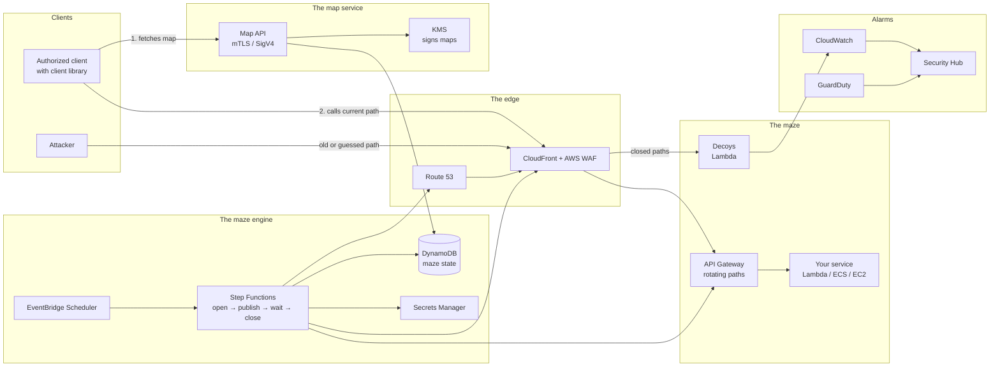

# Cloud Maze

**AWS infrastructure that keeps changing shape. Attackers never find the same path twice, but authorized users always have a way in.**

Cloud Maze is a *moving target defense* concept built on AWS. Internet-facing services, such as APIs, admin interfaces and partner integrations, regularly move their addresses, their routes and their keys. Authorized clients get an up-to-date map and notice nothing. Anyone who mapped the system from the outside is suddenly holding a map that no longer matches. If an attacker still tries to follow the old map, an alarm goes off.

**Want to try it?**
- **For real on AWS:** [`aws/`](aws/README.md) installs phase 1 in your own AWS account. You can do it from a phone through the CloudFormation console.
- **Without an AWS account:** [`sim/`](sim/README.md) has a simulation, both as a web page (`sim/web.html`) and in Python (`python3 demo.py`).

---

## Contents

1. [The problem](#1-the-problem)
2. [The idea](#2-the-idea)
3. [The three rules of the maze](#3-the-three-rules-of-the-maze)
4. [How it works](#4-how-it-works)
5. [Architecture on AWS](#5-architecture-on-aws)
6. [Two journeys through the maze](#6-two-journeys-through-the-maze)
7. [What Cloud Maze does not protect against](#7-what-cloud-maze-does-not-protect-against)
8. [Who it is for](#8-who-it-is-for)
9. [What already exists](#9-what-already-exists)
10. [How to tell it works](#10-how-to-tell-it-works)
11. [Risks and open questions](#11-risks-and-open-questions)
12. [Roadmap](#12-roadmap)
13. [Glossary](#13-glossary)

---

## 1. The problem

**Infrastructure stands still, and attackers have plenty of time.**

Almost every attack starts with reconnaissance. The attacker scans, enumerates and maps which addresses respond, which paths exist, which versions are running and which keys have leaked in old code repositories. MITRE ATT&CK has a tactic of its own for this: *Reconnaissance* (TA0043).

Reconnaissance pays off because the target stands still. An address that was open in March is usually still open in September. An API key that leaked a year ago often still works. The attacker can map at leisure, wait for a new vulnerability and strike when it suits them.

The usual defenses make each door stronger: authentication, firewalls and patching. That is necessary, but every door stays in the same place. Cloud Maze attacks the assumption itself: that the map is correct.

## 2. The idea

Picture a maze whose walls keep moving.

- **For whoever has the map**, it makes no difference. The map updates as fast as the maze does, and there is always an open path to the goal.
- **For whoever drew their own map yesterday**, it is a new maze. The corridors lead the wrong way and the doors are gone.
- **The dead ends are tripwires.** An authorized client never walks into a dead end, because the map does not show them. Anyone who does reveals that they are navigating by an old or stolen map.

On AWS, the walls are things that can already be changed through an API in seconds: paths in API Gateway, DNS names in Route 53, rules in security groups and WAF, and keys in Secrets Manager. What is missing is an engine that changes them in a coordinated, safe way, and a map that keeps authorized clients up to date. That is what Cloud Maze is.

## 3. The three rules of the maze

The concept rests on three rules that must always hold.

**Rule 1: There is always a path for the authorized.**
No change may leave an authorized client without a way in. So Cloud Maze never swaps a wall outright. The new path opens first, the map is updated next, and the old path closes only after an overlap period. During the overlap, both paths work.

**Rule 2: Every map has a best-before date.**
Everything an attacker can observe from the outside, such as paths, hostnames, ports and keys, has a limited lifetime. Once it has passed, the information is worthless. This is the map's *half-life*, and it is the most important measure in the whole system.

**Rule 3: Whoever follows an old map gives themselves away.**
A request to a path that is already closed cannot come from a working authorized client, because they always have the current map. Such requests are treated as strong signals, not noise. The maze also contains deliberate decoys: paths and keys that look real but were never handed to anyone.

## 4. How it works

### The walls: what moves

Cloud Maze moves three kinds of walls, separately or together:

| Wall | What changes | Example |
| --- | --- | --- |
| **Where** | The address of the service | `api.example.com/v1/k7f2q9/orders` becomes `api.example.com/v1/m3x8a1/orders` |
| **How** | The route there | Which source addresses are let in, which region or origin answers |
| **With what** | The keys | API keys, client certificates and secrets are rotated |

How often each wall moves is set per service. An admin interface might move every fifteen minutes. A partner API with slow-moving integrations perhaps once a day.

### The map: how the authorized find their way

Authorized clients fetch a map from a dedicated map service. The map is a small, signed document that describes how to reach the service right now and for how long that holds:

```json
{
  "service": "orders-api",
  "base": "https://api.example.com/v1/m3x8a1",
  "valid_until": "2026-10-28T14:30:00Z",
  "refresh_at": "2026-10-28T14:20:00Z"
}
```

The map service requires strong identity, such as mutual TLS, AWS IAM-signed requests (SigV4) or IAM Roles Anywhere. It is not open to just anyone. A small client library handles everything: it fetches the map, caches it, fetches a new one well before it expires and refetches at once if a request fails. To the developer it looks like an ordinary API call.

### The engine: how changes are made safely

The maze engine runs each move as a controlled process in four steps:

1. **Open** the new path and wait until it responds.
2. **Publish** the new map.
3. **Wait out the overlap**, so every client has time to switch.
4. **Close** the old path and turn it into a tripwire.

If any step fails, the move is aborted and the old path stays. The maze would rather stand still for a while than lock out the authorized.

### The tripwires: how attackers are detected

Closed paths do not disappear. They are watched. Cloud Maze also plants decoys:

- **Old paths:** paths and hostnames that were once real.
- **Fake paths:** paths that look like real services but were never on any map.
- **Fake keys:** secrets placed where an attacker would look, such as configuration files and environment variables, that grant access to nothing.

Because authorized clients never touch these, there are almost no false alarms. In practice, an alarm means someone is using information they should not have, or that has leaked.

### The shadow world: the attacker gets a maze of their own

A source that hits a tripwire does not just get an empty answer. It is put in a shadow world. There, every path works, the real one included, but everything the attacker sees is fake. The attacker believes they have succeeded and spends time on data that does not exist, while every step they take shows what they are looking for. Authorized clients are not affected, because they never hit the tripwires.

### An LLM for content and analysis, not for decisions

An LLM can be connected to write convincing content for the shadow world and to assess alarms in plain language. The maze itself is driven by rules. The guarantee that the authorized always have a way in should not depend on a language model, and an attacker who tries to trick the model should at most be able to influence a piece of text. Any LLM with an OpenAI-compatible API works, such as Groq.

## 5. Architecture on AWS



### The components

| Part | AWS services | Role |
| --- | --- | --- |
| **The edge** | CloudFront, AWS WAF, Route 53 | Receives all traffic. WAF rules that the engine updates pass traffic on current paths and send everything else to the decoys. |
| **The maze** | API Gateway, Lambda, ECS or EC2 | The service itself, unchanged. Only the route to it changes. |
| **The maze engine** | EventBridge Scheduler, Step Functions, DynamoDB | Schedules moves and runs them in the four steps. DynamoDB keeps track of current and past paths. |
| **Keys** | Secrets Manager, ACM | Rotates secrets and manages certificates. Wildcard certificates in ACM let new hostnames go live immediately. |
| **The map service** | API Gateway with mTLS, IAM Roles Anywhere, KMS | Hands out signed maps to authorized clients. The KMS signature exposes a forged map. |
| **Alarms** | CloudWatch, Security Hub, GuardDuty | Collects tripwire alarms alongside AWS's own threat signals. |

### Why AWS fits

- **Everything is an API call.** Every wall in the maze can be moved programmatically in seconds, with no manual work.
- **Pay per use.** The engine and the decoys run on services such as Lambda, Step Functions and EventBridge, which are billed per request. Little runs most of the time, so the base cost is low.
- **Built-in audit.** CloudTrail logs every change the engine makes, so you can see afterwards exactly what the maze looked like at a given moment.
- **Ready-made security infrastructure.** KMS, Secrets Manager, Security Hub and GuardDuty already exist and do not need to be built.

## 6. Two journeys through the maze

### An authorized partner

1. The partner's system starts. The client library fetches the map and identifies itself with its certificate.
2. Requests go to `/v1/m3x8a1/orders`. Everything works as usual.
3. At 14:15 the engine opens a new path, `/v1/q9z4c2/orders`, and publishes a new map.
4. At 14:20 the client library fetches the new map in the background and switches paths.
5. At 14:30 the old path closes. The partner has noticed nothing.

### An attacker

1. The attacker scans and finds `/v1/m3x8a1/orders`, perhaps through a leaked log or an old line of code.
2. The attacker spends time probing the service and prepares an attack.
3. By the time the attack runs, the path has closed. The request lands in the shadow world instead of at the service.
4. The shadow world answers convincingly with fake data. At the same time an alarm goes out with the source address, the time and which old path was used.
5. Because every path is unique to a period of time, you can see *when* the attacker got their information. If the path only appeared in a particular log or system, that points to the leak.

The fifth point is a bonus that is easy to miss: the maze does not just protect, it also traces leaks back in time.

## 7. What Cloud Maze does not protect against

Being honest about the limits matters. Otherwise the concept is just hiding things and hoping for the best.

- **Attackers with a valid identity.** Whoever has stolen an authorized client's certificate can fetch the map like anyone else. Cloud Maze makes such a theft harder to exploit for long, because keys rotate too, but it does not prevent it.
- **Vulnerabilities in the service itself.** Once an attacker reaches the right path, the maze does not protect against a bug in the code. The maze shrinks the time window; it does not fix the bug.
- **The map service is a new target.** Anything that hands out maps becomes attractive to attack. It must be especially well protected and monitored.
- **Denial of service.** Moving addresses does little against someone who just wants to flood the edge with traffic. That calls for AWS Shield.

Cloud Maze should be seen as a layer *on top of* ordinary security, not a replacement for it. It makes ordinary security more effective by removing the attacker's time advantage.

## 8. Who it is for

**The best fit** is organizations with services that must be reachable from the internet, but only by a known set of authorized clients:

- **Partner and B2B APIs**, where the counterparties are known and can use a client library.
- **Admin interfaces** that for practical reasons cannot sit entirely behind a VPN.
- **Internal service-to-service traffic**, where both sides are controlled by the same organization.
- **Highly regulated industries**, such as finance, healthcare and critical infrastructure, where regulations like NIS2 and DORA require active intrusion detection.

**A poor fit** is fully public websites and APIs that anyone should be able to use without preparation. There is no map to hand out.

**Business model:** Cloud Maze can be delivered as a ready-made stack that customers install in their own AWS account, with a license fee per protected service. That suits selling through AWS Marketplace and means the customer's traffic never leaves the customer's own account, which tends to be an important selling point for security buyers.

## 9. What already exists

Cloud Maze builds on known ideas. What is new is how they are combined.

| Existing idea | What it does | How Cloud Maze differs |
| --- | --- | --- |
| **Moving target defense** in research and in endpoint and server products | Changes memory layout and program behavior so malware cannot find its way | Protects the machine, not the routes to cloud services |
| **Zero trust**, such as AWS Verified Access and Cloudflare Access | Checks identity on every request | The door stays put. Cloud Maze moves the door and can be combined with zero trust. |
| **Port knocking** and Single Packet Authorization | Opens a port only after a secret signal | A static secret pattern. Cloud Maze rotates everything and alarms on old patterns. |
| **Honeypots and canary tokens** | Decoys that alarm on contact | Stand-alone. In Cloud Maze every closed path automatically becomes a decoy. |
| **LLM-driven honeypots** | Generate convincing fake systems and answers | Stand-alone deception. In Cloud Maze it is fed by the tripwires of a moving maze. |
| **Key rotation** in Secrets Manager | Replaces secrets on a schedule | Only one wall of three, with no map or tripwires |

What is unique about Cloud Maze is the combination: coordinated rotation of address, route and key, the guarantee that the authorized always have a way in, and the fact that every old path automatically becomes a tripwire that traces leaks back in time and sends the attacker into a shadow world.

## 10. How to tell it works

A security concept has to be measurable. Cloud Maze tracks four measures:

| Measure | What it tells you | Target |
| --- | --- | --- |
| **Map half-life** | How long information about the system stays useful to an attacker | As short as the service can tolerate |
| **Authorized failures** | Share of requests from authorized clients that fail because of a move | Close to zero |
| **Tripwire hits** | Number of requests to closed paths and decoys | Every hit is investigated |
| **False alarms** | Share of hits that turn out to come from authorized clients | Close to zero, otherwise the overlap is too short |

The second and fourth measures decide whether the concept holds up in practice. If authorized clients start tripping, the maze has become too aggressive.

## 11. Risks and open questions

- **Operational complexity.** More moving parts mean more ways to break. The engine must be very easy to understand and debug, and there must be an emergency mode that freezes the maze.
- **Clients that cannot be updated.** Legacy systems and slow-moving partners may struggle to use a client library. One option is a small proxy that handles the map for them.
- **Caching and DNS.** DNS answers and CDN caches can live longer than expected. The overlap must be longer than the longest cache time, and the simplest approach is to rotate paths under a fixed domain name rather than rotating domain names.
- **Logs and debugging.** When addresses change all the time, logs get harder to read. Every log line therefore needs a stable service name in addition to the current path.
- **The perception of hiding things.** Security buyers are rightly skeptical of security that relies on things being unknown. The pitch has to focus on what can be measured: a shorter window for attackers and accurate alarms.

## 12. Roadmap

**Phase 1: Minimum viable version** (built, see [`aws/`](aws/README.md))
A service behind API Gateway with a rotating path, a map service reachable only with IAM, tripwires that send alarms by e-mail, and a shadow world for sources that hit them. An optional LLM assesses alarms and writes the shadow world's content.

**Phase 2: More walls**
Rotation of keys through Secrets Manager and of allowed source addresses in WAF. Fake keys as decoys. Integration with Security Hub.

**Phase 3: Leak tracing**
Unique paths per client and time period, so a tripwire hit points to exactly where the information leaked.

**Phase 4: Product**
Packaged installation through AWS CloudFormation or CDK, an overview of the maze's state and a launch on AWS Marketplace.

## 13. Glossary

| Term | Meaning |
| --- | --- |
| **Moving target defense** | Defense based on the target changing over time, so the attacker's knowledge goes stale |
| **Reconnaissance** | The attacker's mapping of a system before the actual attack |
| **Wall** | Something in the infrastructure that Cloud Maze can move: address, route or key |
| **Map** | A signed document that tells authorized clients how to reach the service right now |
| **Overlap** | The time when both the old and the new path work, so no authorized client is locked out |
| **Tripwire** | A closed path or a decoy that raises an alarm when someone uses it |
| **Shadow world** | Where a source that hit a tripwire ends up: every path works, but all data is fake |
| **Half-life** | How long information about the system stays useful to an attacker |
| **mTLS** | Mutual TLS, where both client and server present certificates |
| **SigV4** | AWS's way of signing requests with an IAM identity |
