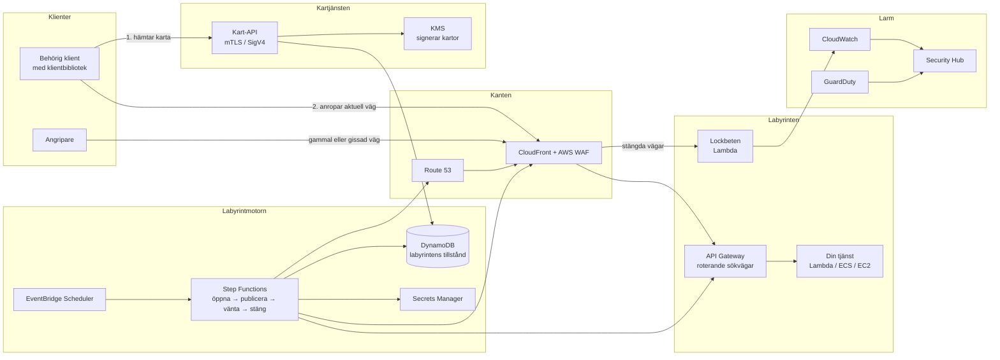

# Cloud Maze

**Infrastruktur i AWS som ändrar form hela tiden. Angripare hittar aldrig samma väg två gånger, men behöriga användare har alltid en väg in.**

Cloud Maze är ett koncept för *moving target defense* (rörligt försvar) byggt på AWS. Tjänster som exponeras mot internet, som API:er, administrativa gränssnitt och partnerintegrationer, flyttar regelbundet sina adresser, sina vägar och sina nycklar. Den som är behörig får en aktuell karta och märker ingenting. Den som har kartlagt systemet utifrån sitter plötsligt med en karta som inte stämmer längre. Om angriparen ändå försöker följa den gamla kartan går ett larm.

**Vill du prova?** Det finns en lokal simulering i [`sim/`](sim/README.md) som du kör med `python3 demo.py`. Den kräver inget AWS-konto.

---

## Innehåll

1. [Problemet](#1-problemet)
2. [Idén](#2-idén)
3. [Labyrintens tre regler](#3-labyrintens-tre-regler)
4. [Hur det fungerar](#4-hur-det-fungerar)
5. [Arkitektur på AWS](#5-arkitektur-på-aws)
6. [Två resor genom labyrinten](#6-två-resor-genom-labyrinten)
7. [Vad Cloud Maze inte skyddar mot](#7-vad-cloud-maze-inte-skyddar-mot)
8. [Vem det är till för](#8-vem-det-är-till-för)
9. [Vad som redan finns](#9-vad-som-redan-finns)
10. [Hur man vet att det fungerar](#10-hur-man-vet-att-det-fungerar)
11. [Risker och öppna frågor](#11-risker-och-öppna-frågor)
12. [Färdplan](#12-färdplan)
13. [Ordlista](#13-ordlista)

---

## 1. Problemet

**Infrastruktur står still, angripare har gott om tid.**

Nästan varje attack börjar med rekognosering. Angriparen skannar, listar och kartlägger vilka adresser som svarar, vilka sökvägar som finns, vilka versioner som körs och vilka nycklar som har läckt i gamla kodrepon. MITRE ATT&CK har en egen taktik för detta: *Reconnaissance* (TA0043).

Det som gör rekognoseringen lönsam är att målet står still. En adress som var öppen i mars är oftast öppen i september. En API-nyckel som läckte för ett år sedan fungerar ofta fortfarande. Angriparen kan kartlägga i lugn och ro, vänta på en ny sårbarhet och slå till när det passar.

Vanliga försvar handlar om att göra varje dörr starkare: autentisering, brandväggar och patchning. Det är nödvändigt, men alla dörrar står kvar på samma plats. Cloud Maze angriper i stället själva förutsättningen, nämligen att kartan stämmer.

## 2. Idén

Tänk dig en labyrint där väggarna flyttar sig hela tiden.

- **För den som har kartan** spelar det ingen roll. Kartan uppdateras i samma takt som labyrinten, och det finns alltid en öppen väg till målet.
- **För den som ritade sin egen karta igår** är labyrinten en ny labyrint. Korridorerna leder fel och dörrarna finns inte kvar.
- **Återvändsgränderna är snubbeltrådar.** En behörig klient går aldrig in i en återvändsgränd, eftersom kartan inte visar dem. Den som ändå gör det avslöjar att den navigerar efter en gammal eller stulen karta.

I AWS motsvaras väggarna av sådant som redan går att ändra via API på några sekunder: sökvägar i API Gateway, DNS-namn i Route 53, regler i säkerhetsgrupper och WAF, och nycklar i Secrets Manager. Det som saknas är en motor som ändrar dem samordnat och säkert, och en karta som håller behöriga klienter uppdaterade. Det är det Cloud Maze är.

## 3. Labyrintens tre regler

Konceptet vilar på tre regler som alltid måste gälla.

**Regel 1: Det finns alltid en väg för den behörige.**
Ingen ändring får lämna en behörig klient utan väg in. Därför byter Cloud Maze aldrig en vägg rakt av. Den nya vägen öppnas först, kartan uppdateras sedan, och den gamla vägen stängs först när en överlappsperiod har gått ut. Under överlappet fungerar båda vägarna.

**Regel 2: Varje karta har ett bäst-före-datum.**
Allt som en angripare kan observera utifrån, som sökvägar, värdnamn, portar och nycklar, har en begränsad livslängd. När den har gått ut är informationen värdlös. Det här kallas kartans *halveringstid*, och det är det viktigaste måttet i hela systemet.

**Regel 3: Den som följer en gammal karta avslöjar sig.**
Ett anrop mot en väg som redan är stängd kan inte komma från en välfungerande behörig klient, eftersom de alltid har aktuell karta. Sådana anrop behandlas därför som starka signaler, inte som brus. Labyrinten innehåller också avsiktliga lockbeten: vägar och nycklar som ser äkta ut men aldrig har delats ut till någon.

## 4. Hur det fungerar

### Väggarna: vad som flyttas

Cloud Maze flyttar tre sorters väggar, var för sig eller i kombination:

| Vägg | Vad som ändras | Exempel |
| --- | --- | --- |
| **Var** | Adressen till tjänsten | `api.exempel.se/v1/k7f2q9/orders` blir `api.exempel.se/v1/m3x8a1/orders` |
| **Hur** | Vägen dit | Vilka källadresser som släpps in, vilken region eller vilket ursprung som svarar |
| **Med vad** | Nycklarna | API-nycklar, klientcertifikat och hemligheter roteras |

Hur ofta varje vägg flyttas ställs in per tjänst. Ett administrativt gränssnitt kan flytta sig var femtonde minut. Ett partner-API med tröga integrationer kanske en gång per dygn.

### Kartan: hur behöriga hittar rätt

Behöriga klienter hämtar en karta från en egen kartjänst. Kartan är ett litet, signerat dokument som beskriver hur tjänsten nås just nu och hur länge det gäller:

```json
{
  "tjänst": "orders-api",
  "bas": "https://api.exempel.se/v1/m3x8a1",
  "giltig_till": "2026-10-28T14:30:00Z",
  "nästa_hämtning": "2026-10-28T14:20:00Z"
}
```

Kartjänsten kräver stark identitet, till exempel ömsesidig TLS, AWS IAM-signerade anrop (SigV4) eller IAM Roles Anywhere. Den är alltså inte öppen för vem som helst. Ett litet klientbibliotek sköter allt automatiskt: det hämtar kartan, sparar den, hämtar en ny i god tid före utgångstiden och hämtar om direkt om ett anrop skulle misslyckas. För utvecklaren ser det ut som ett vanligt API-anrop.

### Motorn: hur ändringarna görs säkert

Labyrintmotorn kör varje flytt som en kontrollerad process i fyra steg:

1. **Öppna** den nya vägen och vänta tills den svarar.
2. **Publicera** den nya kartan.
3. **Vänta ut överlappet**, så att alla klienter hinner byta.
4. **Stäng** den gamla vägen och gör den till en snubbeltråd.

Om något steg misslyckas avbryts flytten och den gamla vägen står kvar. Labyrinten blir hellre stillastående en stund än att stänga ute behöriga.

### Snubbeltrådarna: hur angripare upptäcks

Stängda vägar försvinner inte helt. De övervakas. Dessutom planterar Cloud Maze lockbeten:

- **Gamla vägar:** sökvägar och värdnamn som en gång var äkta.
- **Falska vägar:** sökvägar som ser ut som äkta tjänster men aldrig har funnits på någon karta.
- **Falska nycklar:** hemligheter som läggs där en angripare skulle leta, till exempel i konfigurationsfiler och miljövariabler, men som inte ger tillgång till något.

Eftersom behöriga klienter aldrig rör sådant blir det nästan inga falsklarm. Ett larm betyder i praktiken att någon använder information som de inte borde ha, eller som har läckt.

## 5. Arkitektur på AWS



### Komponenterna

| Del | AWS-tjänster | Roll |
| --- | --- | --- |
| **Kanten** | CloudFront, AWS WAF, Route 53 | Tar emot all trafik. WAF-regler som motorn uppdaterar skickar vidare trafik på aktuella vägar och styr allt annat till lockbetena. |
| **Labyrinten** | API Gateway, Lambda, ECS eller EC2 | Själva tjänsten, oförändrad. Bara vägen dit ändras. |
| **Labyrintmotorn** | EventBridge Scheduler, Step Functions, DynamoDB | Schemalägger flyttar och kör dem i de fyra stegen. DynamoDB håller reda på nuvarande och tidigare vägar. |
| **Nycklar** | Secrets Manager, ACM | Roterar hemligheter och hanterar certifikat. Wildcard-certifikat i ACM gör att nya värdnamn kan tas i bruk direkt. |
| **Kartjänsten** | API Gateway med mTLS, IAM Roles Anywhere, KMS | Delar ut signerade kartor till behöriga klienter. KMS-signaturen gör att en förfalskad karta upptäcks. |
| **Larm** | CloudWatch, Security Hub, GuardDuty | Samlar snubbeltrådarnas larm tillsammans med AWS egna hotsignaler. |

### Varför AWS passar

- **Allt är ett API-anrop.** Varje vägg i labyrinten kan flyttas programmatiskt och på sekunder, utan manuellt arbete.
- **Betalning per användning.** Motorn och lockbetena bygger på tjänster som Lambda, Step Functions och EventBridge, som kostar per anrop. Det är sällan något körs, så grundkostnaden blir låg.
- **Inbyggd granskning.** CloudTrail loggar varje ändring motorn gör, så det går i efterhand att se exakt hur labyrinten såg ut vid en viss tidpunkt.
- **Färdig säkerhetsinfrastruktur.** KMS, Secrets Manager, Security Hub och GuardDuty finns redan och behöver inte byggas.

## 6. Två resor genom labyrinten

### En behörig partner

1. Partnerns system startar. Klientbiblioteket hämtar kartan och identifierar sig med sitt certifikat.
2. Anropen går mot `/v1/m3x8a1/orders`. Allt fungerar som vanligt.
3. Kl. 14:15 öppnar motorn en ny väg, `/v1/q9z4c2/orders`, och publicerar en ny karta.
4. Kl. 14:20 hämtar klientbiblioteket den nya kartan i bakgrunden och byter väg.
5. Kl. 14:30 stängs den gamla vägen. Partnern har inte märkt någonting.

### En angripare

1. Angriparen skannar och hittar `/v1/m3x8a1/orders`, kanske via en läckt logg eller en gammal kodrad.
2. Angriparen lägger tid på att undersöka tjänsten och förbereder ett angrepp.
3. När angreppet körs har vägen redan stängts. Anropet hamnar hos ett lockbete i stället för hos tjänsten.
4. Lockbetet svarar trovärdigt men ger ingen tillgång. Samtidigt skickas ett larm till Security Hub med källadress, tidpunkt och vilken gammal väg som användes.
5. Eftersom varje väg är unik för en viss tidsperiod går det att se *när* angriparen fick sin information. Om vägen bara fanns i en viss logg eller ett visst system pekar det ut läckan.

Den femte punkten är en bonus som är lätt att missa: labyrinten skyddar inte bara, den spårar också läckor bakåt i tiden.

## 7. Vad Cloud Maze inte skyddar mot

Det är viktigt att vara ärlig om gränserna. Annars blir konceptet bara att gömma saker och hoppas på det bästa.

- **Angripare med giltig identitet.** Den som har stulit en behörig klients certifikat kan hämta kartan som vem som helst. Cloud Maze gör den stölden svårare att utnyttja länge, eftersom nycklar också roteras, men den hindrar den inte.
- **Sårbarheter i själva tjänsten.** När en angripare väl når rätt väg skyddar labyrinten inte mot en bugg i koden. Labyrinten krymper tidsfönstret, den lagar inte buggen.
- **Kartjänsten är ett nytt mål.** Allt som delar ut kartor blir attraktivt att angripa. Den måste därför vara extra hårt skyddad och övervakad.
- **Överbelastningsattacker.** Att flytta adresser hjälper lite mot den som bara vill dränka kanten med trafik. Där behövs AWS Shield.

Cloud Maze ska alltså ses som ett lager *ovanpå* vanlig säkerhet, inte som en ersättning för den. Det gör vanlig säkerhet effektivare genom att ta bort angriparens tidsfördel.

## 8. Vem det är till för

**Bäst passar** organisationer som har tjänster som måste vara nåbara från internet, men bara av ett känt antal behöriga klienter:

- **Partner- och B2B-API:er**, där motparterna är kända och kan använda ett klientbibliotek.
- **Administrativa gränssnitt** som av praktiska skäl inte kan ligga helt bakom VPN.
- **Interna tjänster mellan system**, där båda sidor kontrolleras av samma organisation.
- **Branscher med höga krav**, som finans, vård och kritisk infrastruktur, där regelverk som NIS2 och DORA ställer krav på aktiv upptäckt av intrång.

**Sämre passar** helt publika webbplatser och API:er där vem som helst ska kunna ansluta utan förberedelse. Där finns ingen karta att dela ut.

**Affärsmodell:** Cloud Maze kan levereras som en färdig stack som kunden installerar i sitt eget AWS-konto, med licensavgift per skyddad tjänst. Det passar ett försäljningsupplägg via AWS Marketplace och gör att kundens trafik aldrig lämnar kundens eget konto, vilket brukar vara ett viktigt säljargument för säkerhetsköpare.

## 9. Vad som redan finns

Cloud Maze bygger på kända idéer. Det nya ligger i hur de kombineras.

| Befintlig idé | Vad den gör | Skillnaden mot Cloud Maze |
| --- | --- | --- |
| **Moving target defense** i forskning och i produkter för datorer och servrar | Ändrar minneslayout och programbeteende så att skadlig kod inte hittar rätt | Skyddar maskinen, inte vägarna till molntjänster |
| **Zero trust**, till exempel AWS Verified Access och Cloudflare Access | Kontrollerar identitet vid varje anrop | Dörren står still. Cloud Maze flyttar dörren och kan kombineras med zero trust. |
| **Port knocking** och Single Packet Authorization | Öppnar en port först efter en hemlig signal | Ett statiskt hemligt mönster. Cloud Maze roterar allt och larmar på gamla mönster. |
| **Honeypots och canary tokens** | Lockbeten som larmar vid kontakt | Fristående. I Cloud Maze blir varje stängd väg automatiskt ett lockbete. |
| **Nyckelrotation** i Secrets Manager | Byter hemligheter regelbundet | Bara en vägg av tre, och utan karta eller snubbeltrådar |

Det unika i Cloud Maze är kombinationen av tre saker: samordnad rotation av adress, väg och nyckel, garantin att behöriga alltid har en väg in, och att varje gammal väg automatiskt blir en snubbeltråd som kan spåra läckor bakåt i tiden.

## 10. Hur man vet att det fungerar

Ett säkerhetskoncept måste gå att mäta. Cloud Maze följer fyra mått:

| Mått | Vad det säger | Mål |
| --- | --- | --- |
| **Kartans halveringstid** | Hur länge information om systemet är användbar för en angripare | Så kort som tjänsten tål |
| **Behöriga misslyckanden** | Andel anrop från behöriga klienter som misslyckas på grund av en flytt | Nära noll |
| **Snubbeltrådsträffar** | Antal anrop mot stängda vägar och lockbeten | Varje träff utreds |
| **Falsklarm** | Andel träffar som visar sig komma från behöriga klienter | Nära noll, annars är överlappet för kort |

Det andra och det fjärde måttet är de som avgör om konceptet håller i praktiken. Om behöriga klienter börjar snubbla har labyrinten blivit för aggressiv.

## 11. Risker och öppna frågor

- **Driftkomplexitet.** Fler rörliga delar betyder fler sätt att gå sönder. Motorn måste vara mycket enkel att förstå och felsöka, och det måste finnas ett nödläge som fryser labyrinten.
- **Klienter som inte kan uppdateras.** Äldre system och tröga partner kan ha svårt att använda ett klientbibliotek. Ett alternativ är en liten proxy som sköter kartan åt dem.
- **Cachning och DNS.** DNS-svar och CDN-cachar kan leva längre än förväntat. Överlappsperioden måste vara längre än den längsta cachetiden, och det enklaste är att rotera sökvägar under ett fast domännamn snarare än att rotera domännamn.
- **Loggar och felsökning.** När adresser ändras hela tiden blir loggar svårare att läsa. Varje loggrad behöver därför märkas med ett stabilt tjänstenamn utöver den aktuella vägen.
- **Uppfattningen att det är att gömma saker.** Säkerhetsköpare är med rätta skeptiska mot säkerhet som bygger på att saker är okända. Säljbudskapet måste fokusera på det som går att mäta: kortare tidsfönster för angripare och träffsäkra larm.

## 12. Färdplan

**Fas 1: Minsta fungerande version**
En tjänst bakom API Gateway med roterande sökväg, en kartjänst med IAM-signerade anrop, ett klientbibliotek för ett programspråk och larm i CloudWatch när någon träffar en stängd väg.

**Fas 2: Fler väggar**
Rotation av nycklar via Secrets Manager och av tillåtna källadresser i WAF. Falska vägar och falska nycklar som lockbeten. Koppling till Security Hub.

**Fas 3: Spårning av läckor**
Unika vägar per klient och tidsperiod, så att en snubbeltrådsträff pekar ut exakt varifrån informationen läckte.

**Fas 4: Produkt**
Färdig installation via AWS CloudFormation eller CDK, en överblick över labyrintens tillstånd och lansering på AWS Marketplace.

## 13. Ordlista

| Ord | Betydelse |
| --- | --- |
| **Moving target defense** | Försvar som bygger på att målet ändras över tid, så att angriparens kunskap blir inaktuell |
| **Rekognosering** | Angriparens kartläggning av ett system innan själva angreppet |
| **Vägg** | Något i infrastrukturen som Cloud Maze kan flytta: adress, väg eller nyckel |
| **Karta** | Ett signerat dokument som talar om för behöriga klienter hur tjänsten nås just nu |
| **Överlapp** | Tiden då både gammal och ny väg fungerar, så att ingen behörig klient stängs ute |
| **Snubbeltråd** | En stängd väg eller ett lockbete som larmar när någon använder det |
| **Halveringstid** | Hur länge information om systemet är användbar för en angripare |
| **mTLS** | Ömsesidig TLS, där både klient och server visar certifikat |
| **SigV4** | AWS sätt att signera anrop med IAM-identitet |
